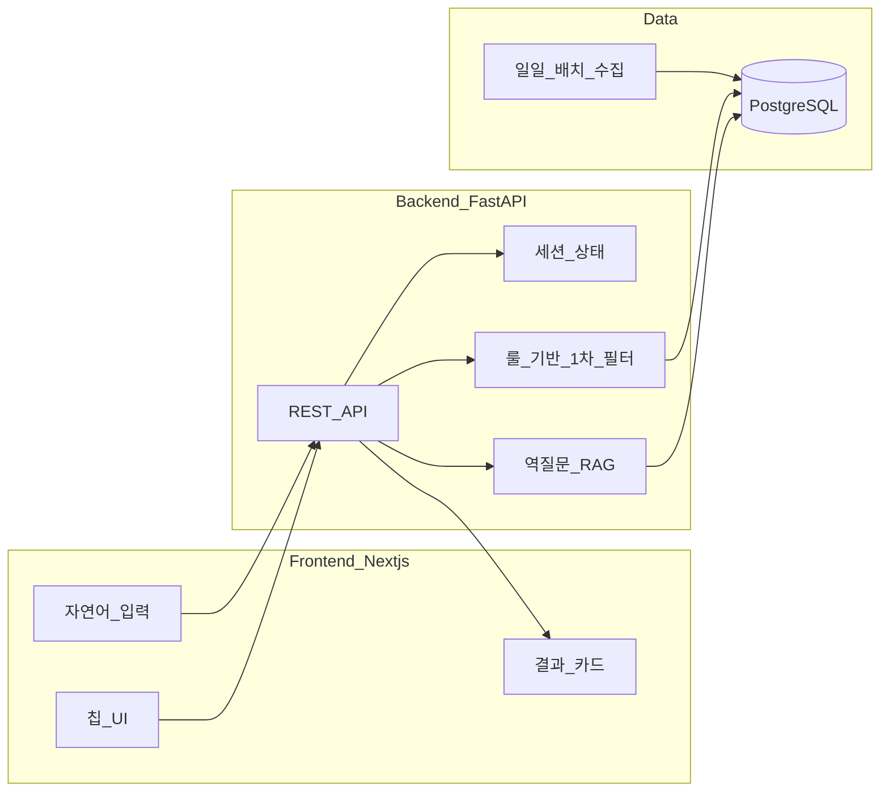

# 아키텍처

> 현재 구현 상태: 1차 Build(골격 + `/health`)까지. 점선 이후 구성요소는 계획 단계.

## 처리 흐름

## 4단계 파이프라인

1. 자연어 입력 → 지역·취업상태·관심분야 1차 키워드 추출
2. 로컬 DB에서 후보군 선별 (정책 30~50, 적금 10~20)
3. 후보군을 가르는 핵심 자격 변수 식별 → LLM이 3~5개 역질문(JSON) 생성
4. 답변으로 최종 후보 확정 → LLM이 DB 메타데이터 기반 선정 사유 서술 + 공식 URL 결합

## 현재 코드 구조

| 경로 | 역할 |
|------|------|
| `app/main.py` | FastAPI 앱 팩토리 |
| `app/api/` | 라우터 (현재 `health`) |
| `app/core/config.py` | `pydantic-settings` 기반 설정 |
| `app/core/database.py` | SQLAlchemy async 엔진 (DATABASE_URL 있을 때만 생성) |
| `compose.yaml` | 로컬 PostgreSQL 16 |

## 변경 이력

- 2026-10-12: 초기 골격 작성
