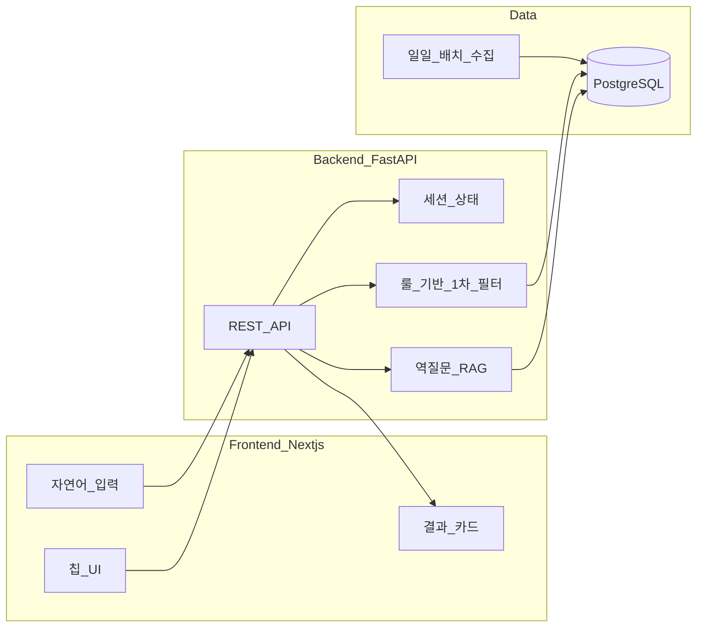
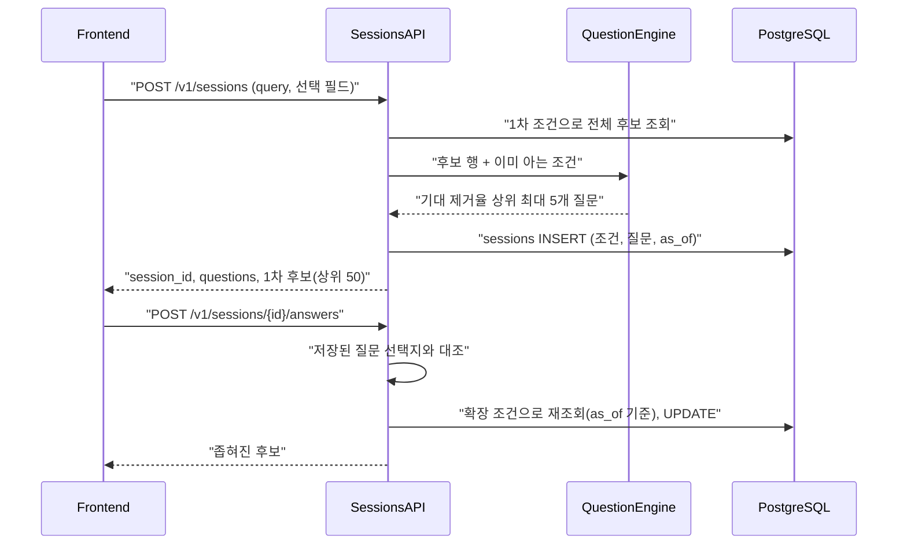
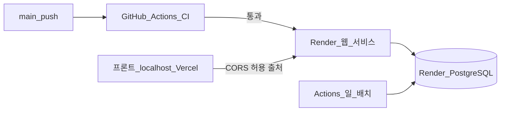

# 아키텍처

> 현재 구현 상태: 스키마, 일 배치 적재, 필드 채움률 리포트, 1차 룰 필터 API(`POST /v1/candidates`), 역질문 세션 API(`/v1/sessions`, 템플릿 질문·답변 반영 재필터)까지. LLM 질문 문구화·선정 사유는 다음 단계.

## 처리 흐름

## 4단계 파이프라인

1. 자연어 입력 → 지역·취업상태·관심분야 1차 키워드 추출
2. 로컬 DB에서 후보군 선별 (정책 30 ~ 50, 적금 10 ~ 20)
3. 후보군을 가르는 핵심 자격 변수 식별(서버가 기대 제거율로 선정) → 3~5개 역질문(JSON). 지금은 템플릿 문구, LLM은 문구만 다듬을 예정 (근거: `decisions/008`)
4. 답변으로 최종 후보 확정(구현됨) → LLM이 DB 메타데이터 기반 선정 사유 서술 + 공식 URL 결합

### 역질문 세션 흐름

## 현재 코드 구조

| 경로 | 역할 |
|------|------|
| `app/main.py` | FastAPI 앱 팩토리 |
| `app/api/` | 라우터 (`health`, `v1/candidates`, `v1/sessions`), `deps.py`(읽기 연결, 쓰기 트랜잭션 `get_db_transaction`, 기준일 의존성) |
| `app/schemas/candidates.py` | 후보 API 요청·응답 Pydantic 모델 (취업상태·관심분야 enum, 링크 출처). `AppliedConditions`에 역질문 답 필드(혼인·학력·소득 구간·시군구 코드) |
| `app/schemas/sessions.py` | 세션 요청·응답, 질문(`variable`, 선택지 `value`/`label`, `affected`)·답 모델 |
| `app/services/candidate_service.py` | 1차 룰 필터 SQL: 마감 제외·나이·시도·취업상태·관심분야 + 역질문 답(혼인·학력·소득·시군구), 정렬(상태 > 시도 전체·전국·일부 시군구 > 마감 임박, 시군구를 알면 내 시군구 정책은 시도 전체와 같은 순위), 정책명 정규화 중복 제거, 공식 링크 선택. 행 조회(`fetch_policy_rows`, limit 없음 허용)와 응답 조립(`build_response`) 분리 (근거: `decisions/005`, `006`, `008`) |
| `app/services/question_engine.py` | 역질문 변수 레지스트리와 기대 제거율 점수, 템플릿 질문 생성, 답 반영 (DB·LLM 미사용, 근거: `decisions/008`) |
| `app/services/session_service.py` | 세션 생성(전체 후보로 질문 선정, INSERT)·조회·답변(선택지 대조, `as_of` 기준 재조회, 덮어쓰기) |
| `app/services/query_hints.py` | 자연어 질의에서 지역·취업상태·나이·관심분야 규칙 사전 추출 (LLM 미사용) |
| `app/core/config.py` | `pydantic-settings` 기반 설정 (CORS 허용 출처, `postgres://`·`sslmode` URL을 asyncpg 형식으로 변환) |
| `app/core/database.py` | SQLAlchemy async 엔진 (DATABASE_URL 있을 때만 생성) |
| `app/models/` | ORM 모델: `Policy`, `FinancialCompany`, `SavingProduct`, `SavingProductOption`, `IngestRun`, `QuestionSession` |
| `app/ingest/http.py` | 수집 공통 HTTP: 요청 간 0.5초 지연, 3회 재시도(연결 오류·429/5xx·비 JSON), API 키 마스킹 |
| `app/ingest/ontong.py` | 온통청년 `getPlcy` 클라이언트 (pageSize 100, `totCount` 기반 페이지네이션, `plcyNo` 중복 제거) |
| `app/ingest/fss.py` | 금감원 `savingProductsSearch`·`companySearch` 클라이언트 (권역별 `max_page_no` 페이지네이션) |
| `app/ingest/codes.py` | 온통청년 코드표 (혼인·소득·취업상태·학력·전공·특화·신청기간, "제한없음" 코드) |
| `app/ingest/sigungu.py` | 법정 시군구 이름표(시군구 질문 선택지)와 일반구 묶음. 시도 12·28·36은 제외 |
| `app/ingest/pipeline.py` | 수집 → 정규화(중복·실패 집계) → 소스별 단일 트랜잭션 적재, `ingest_runs` 기록 |
| `app/ingest/loader.py` | `ON CONFLICT DO UPDATE` upsert(500행 배치), 미수집 행 삭제는 기존 행 5% 상한(근거: `decisions/003-ingest-prune-safety.md`), 적금 옵션은 받은 상품만 교체 |
| `app/ingest/__main__.py` | 적재 CLI `uv run python -m app.ingest --source all\|ontong\|fss` |
| `app/ingest/report.py` | 필드 채움률 리포트 CLI `uv run python -m app.ingest.report` (읽기 전용, 크롤링 필요성 판단) |
| `app/ingest/normalize.py` | 원문 → 모델 컬럼 dict 순수 함수 (공백 날짜, 신청기간·사업기간 파싱, 시군구→시도, URL 검증, `is_youth`, 미등록 코드 집계) |
| `app/services/policy_status.py` | 정책 신청 가능 여부를 조회 시점에 판정 (신청 가능 / 신청 예정 / 마감 / 신청기간 확인 필요, 근거: `decisions/004-policy-availability.md`) |
| `alembic/` | 마이그레이션 (async 템플릿, URL은 `Settings`에서 읽음) |
| `compose.yaml` | 로컬 PostgreSQL 16 |
| `Dockerfile` | uv 기반 이미지. 기동 시 `alembic upgrade head` 후 uvicorn (`$PORT`) |
| `render.yaml` | Render Blueprint: 무료 웹 서비스 + PostgreSQL, CI 통과 시 자동 배포 (근거: `decisions/007-dev-deploy-render.md`) |
| `.github/workflows/ci.yml` | push·PR마다 ruff, Postgres 서비스 컨테이너에 마이그레이션 후 pytest |
| `.github/workflows/ingest.yml` | 일 배치 (매일 04:00 KST, 수동 실행 가능), Secrets의 Render DB 외부 URL로 적재 |

## 배포 (개발 서버)

## 데이터 스키마

정규화 컬럼 + 원문 `raw JSONB` 이중 저장 (근거: `decisions/002-schema-normalized-plus-raw.md`).

| 테이블 | 키 | 내용 |
|------|------|------|
| `policies` | `plcy_no` | 온통청년 정책. 대·중분류(배열), 나이·혼인·소득·취업상태·학력·특화·지역 코드, 신청기간, 사업기간(`biz_start`/`biz_end`), URL. GIN: `categories`, `sido_codes`, `job_codes` |
| `financial_companies` | `fin_co_no` | 금감원 금융회사. `homepage_url`을 적금 공식 URL로 사용 |
| `saving_products` | `(fin_co_no, fin_prdt_cd)` | 금감원 적금 기본 정보, `is_youth` 플래그 (회사 FK 없음) |
| `saving_product_options` | `id`, 유니크 `(상품, rate_type, reserve_type, term_months)` | 기간·적립방식별 기본/최고 금리 |
| `ingest_runs` | `id` | 배치 실행 기록 (source, status, 건수, 오류) |
| `sessions` | `id` (UUID) | 역질문 세션. 기준일 `as_of`, 질의, 1차 조건·질문·답(JSONB), 답 전후 정책 ID(`initial_policy_ids`/`final_policy_ids`), 생성 24시간 뒤 `expires_at` (인덱스) |

## 변경 이력

- 2026-10-12: 초기 골격 작성
- 2026-10-17: Alembic + 모델 5개, 첫 마이그레이션 추가
- 2026-10-26: 적재 품질 리포트 CLI (`app/ingest/report.py`). 전체·서울·경기·지역 무관 필드 채움률과 크롤링 판단
- 2026-10-26: 사업기간 컬럼(`biz_start`/`biz_end`) 추가, `app/services/policy_status.py`로 신청 가능 여부 판정
- 2026-10-26: 1차 룰 필터 `POST /v1/candidates` (정책 50·적금 20 상한, `app/schemas/`, `candidate_service`, `query_hints`)
- 2026-10-26: 개발 서버 배포 구성 (Dockerfile, `render.yaml`, CI·일 배치 워크플로, CORS 설정, DB URL asyncpg 변환)
- 2026-11-03: 역질문 세션 (LLM 없는 E2E). `question_engine`, `session_service`, `/v1/sessions` 3개 API, `sessions` 테이블, 혼인·학력·소득·시군구 필터, 시군구 이름표
