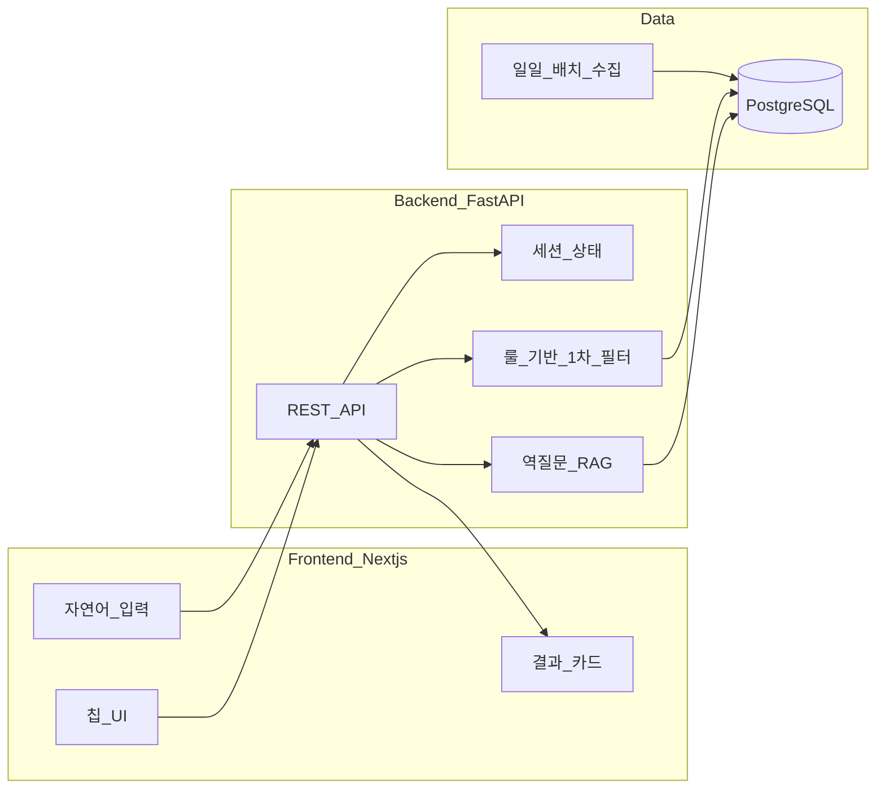

# 아키텍처

> 현재 구현 상태: 1차 Build(골격 + `/health`)까지. 점선 이후 구성요소는 계획 단계.

## 처리 흐름

## 4단계 파이프라인

1. 자연어 입력 → 지역·취업상태·관심분야 1차 키워드 추출
2. 로컬 DB에서 후보군 선별 (정책 30 ~ 50, 적금 10 ~ 20)
3. 후보군을 가르는 핵심 자격 변수 식별 → LLM이 3~5개 역질문(JSON) 생성
4. 답변으로 최종 후보 확정 → LLM이 DB 메타데이터 기반 선정 사유 서술 + 공식 URL 결합

## 현재 코드 구조

| 경로 | 역할 |
|------|------|
| `app/main.py` | FastAPI 앱 팩토리 |
| `app/api/` | 라우터 (현재 `health`) |
| `app/core/config.py` | `pydantic-settings` 기반 설정 |
| `app/core/database.py` | SQLAlchemy async 엔진 (DATABASE_URL 있을 때만 생성) |
| `app/models/` | ORM 모델: `Policy`, `FinancialCompany`, `SavingProduct`, `SavingProductOption`, `IngestRun` |
| `app/ingest/http.py` | 수집 공통 HTTP: 요청 간 0.5초 지연, 3회 재시도(연결 오류·429/5xx·비 JSON), API 키 마스킹 |
| `app/ingest/ontong.py` | 온통청년 `getPlcy` 클라이언트 (pageSize 100, `totCount` 기반 페이지네이션, `plcyNo` 중복 제거) |
| `app/ingest/fss.py` | 금감원 `savingProductsSearch`·`companySearch` 클라이언트 (권역별 `max_page_no` 페이지네이션) |
| `app/ingest/codes.py` | 온통청년 코드표 (혼인·소득·취업상태·학력·전공·특화·신청기간, "제한없음" 코드) |
| `app/ingest/pipeline.py` | 수집 → 정규화(중복·실패 집계) → 소스별 단일 트랜잭션 적재, `ingest_runs` 기록 |
| `app/ingest/loader.py` | `ON CONFLICT DO UPDATE` upsert(500행 배치), 전체 수집 시에만 미수집 행 삭제, 적금 옵션은 권역 단위 교체 |
| `app/ingest/__main__.py` | 적재 CLI `uv run python -m app.ingest --source all\|ontong\|fss` |
| `app/ingest/normalize.py` | 원문 → 모델 컬럼 dict 순수 함수 (공백 날짜, 신청기간 파싱, 시군구→시도, URL 검증, `is_youth`, 미등록 코드 집계) |
| `alembic/` | 마이그레이션 (async 템플릿, URL은 `Settings`에서 읽음) |
| `compose.yaml` | 로컬 PostgreSQL 16 |

## 데이터 스키마

정규화 컬럼 + 원문 `raw JSONB` 이중 저장 (근거: `decisions/002-schema-normalized-plus-raw.md`).

| 테이블 | 키 | 내용 |
|------|------|------|
| `policies` | `plcy_no` | 온통청년 정책. 대·중분류(배열), 나이·혼인·소득·취업상태·학력·특화·지역 코드, 신청기간, URL. GIN: `categories`, `sido_codes`, `job_codes` |
| `financial_companies` | `fin_co_no` | 금감원 금융회사. `homepage_url`을 적금 공식 URL로 사용 |
| `saving_products` | `(fin_co_no, fin_prdt_cd)` | 금감원 적금 기본 정보, `is_youth` 플래그 (회사 FK 없음) |
| `saving_product_options` | `id`, 유니크 `(상품, rate_type, reserve_type, term_months)` | 기간·적립방식별 기본/최고 금리 |
| `ingest_runs` | `id` | 배치 실행 기록 (source, status, 건수, 오류) |

## 변경 이력

- 2026-10-12: 초기 골격 작성
- 2026-10-17: Alembic + 모델 5개, 첫 마이그레이션 추가
