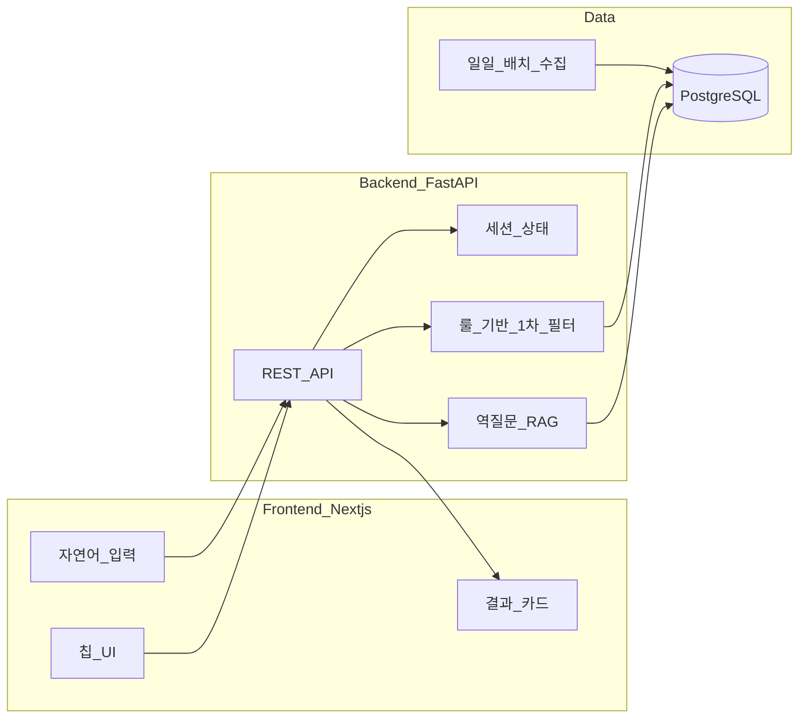
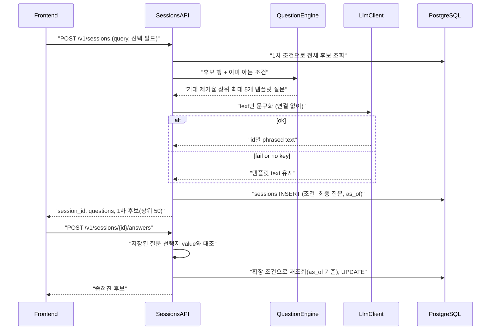
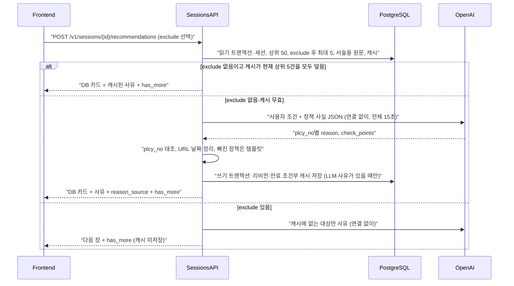
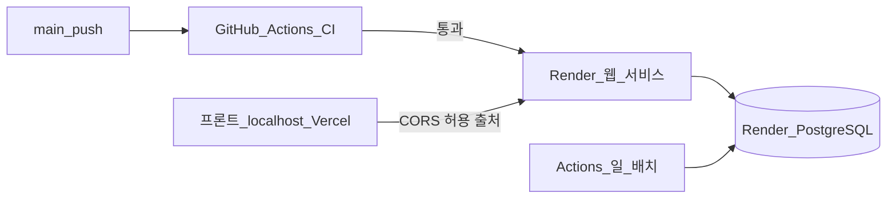

# 아키텍처

> 현재 구현 상태: 스키마, 일 배치 적재, 필드 채움률 리포트, 1차 룰 필터 API(`POST /v1/candidates`, 가짜 전국 제외·`region_scope`, 근거: `decisions/013`), 역질문 세션 API(`/v1/sessions`, 서버 선정 변수·선택지 + 시도 미입력 시 `sido` 칩 고정 + LLM 질문 문구화·템플릿 폴백, 답변 반영 재필터, 근거: `decisions/008`, `012`, `013`), 최종 후보 LLM 선정 사유(`POST /v1/sessions/{id}/recommendations`, 템플릿 대체·세션 캐시, `exclude_plcy_nos`·`has_more`로 상위 50 안 「더 보기」, 근거: `decisions/011`, `014`)까지. 추천 대상은 청년 정책만이다(적금 제외, 근거: `decisions/010`).

## 처리 흐름

## 4단계 파이프라인

1. 자연어 입력 → 지역·취업상태·관심분야 1차 키워드 추출
2. 로컬 DB에서 정책 후보군 선별 (30 ~ 50). 시도 없으면 유효 전국만, 가짜 전국(기초·광역 지자체 기관+전국 zip)은 제외 (근거: `decisions/013`, `016`)
3. 후보군을 가르는 핵심 자격 변수 식별(서버가 기대 제거율로 선정) → 3~5개 역질문(JSON). 시도 미입력이면 `sido`를 맨 앞 고정. 변수·선택지는 서버 고정, `text`만 LLM이 다듬고 실패·키 없음이면 템플릿 유지 (근거: `decisions/008`, `012`, `013`)
4. 답변으로 최종 후보 확정 → 상위 5건에 LLM이 DB 메타데이터 기반 선정 사유 서술. 공식 URL·마감일·자격 표시는 DB 카드로만 만들고, LLM 실패·키 없음이면 템플릿 사유. `exclude_plcy_nos`로 상위 50 안 다음 장·`has_more` (근거: `decisions/011`, `014`)

### 역질문 세션 흐름

### 선정 사유 흐름

## 현재 코드 구조

| 경로 | 역할 |
|------|------|
| `app/main.py` | FastAPI 앱 팩토리 |
| `app/api/` | 라우터 (`health`, `v1/candidates`, `v1/sessions`), `deps.py`(읽기 연결, 쓰기 트랜잭션 `get_db_transaction`, 호출마다 짧은 트랜잭션을 여는 `get_db_connector`, LLM 클라이언트 `get_llm_client`, 기준일 의존성), `rate_limit.py`(세션 쓰기·선정 사유 경로의 메모리 기반 IP별·전체 요청 제한, 근거: `decisions/009`, `011`) |
| `app/schemas/candidates.py` | 후보 API 요청·응답 Pydantic 모델 (취업상태·관심분야 enum, 링크 출처). `AppliedConditions`에 역질문 답 필드(혼인·학력·소득 구간·시군구 코드) |
| `app/schemas/sessions.py` | 세션 요청·응답, 질문(`variable`, 선택지 `value`/`label`, `affected`)·답 모델, 선정 사유 요청(`RecommendationRequest.exclude_plcy_nos`)·응답(`Recommendation` + `has_more`)과 캐시 항목(`CachedReason`) |

| `app/services/candidate_service.py` | 1차 룰 필터 SQL: 마감 제외·나이·시도·취업상태·관심분야 + 역질문 답(혼인·학력·소득·시군구), 정렬(상태 > 시도 전체·유효 전국·일부 시군구 > 마감 임박, 시군구를 알면 내 시군구 정책은 시도 전체와 같은 순위), 정책명 정규화 중복 제거, 공식 링크 선택. 행 조회(`fetch_policy_rows`, limit 없음 허용)와 응답 조립(`build_response`) 분리 (근거: `decisions/005`, `006`, `008`, `013`) |
| `app/services/region_scope.py` | 전국 zip·기초지자체·광역 시도명 기관명 판정. 유효 전국/가짜 전국 SQL·파이썬 헬퍼 (근거: `decisions/013`, `016`) |
| `app/services/question_engine.py` | 역질문 변수 레지스트리와 기대 제거율 점수, 템플릿 질문 생성, 답 반영. 시도 미입력이면 `sido` 질문을 맨 앞 고정 삽입 (DB·LLM 미사용, 근거: `decisions/008`, `013`) |
| `app/services/question_phrasing.py` | 세션 생성 시 질문 `text`만 LLM 문구화. id 대조·URL/날짜 정리·템플릿 폴백. 후보·선택지는 프롬프트에 넣지 않음 (근거: `decisions/012`) |
| `app/services/session_service.py` | 세션 생성(전체 후보로 질문 선정 → 연결 밖 문구화 → INSERT)·조회·답변(선택지 대조, `as_of` 기준 재조회, 덮어쓰기, 선정 사유 캐시 비우기·`answers_revision` 증가) |
| `app/services/recommendation_service.py` | 최종 후보 상위 5건 선정 사유: 프롬프트 구성, LLM 출력 `plcy_no` 대조·URL/날짜 정리, SQL이 보장하는 자격만 쓰는 템플릿 사유, 세션 캐시(리비전 조건부 저장), `exclude`·`has_more`(상위 50 풀, exclude 시 부분 재사용·미저장), 읽기·LLM·쓰기 분리. 프롬프트 원문은 필드별 상한·설명 중복 제거·압축 JSON (근거: `decisions/011`, `014`, `015`) |
| `app/llm/client.py` | `LlmClient` 프로토콜과 `OpenAIClient`(Pydantic 구조화 출력, 재시도 포함 전체 시간 한도, 모든 실패를 `LlmError`로 통일, 토큰·지연 로그). `OPENAI_BASE_URL`이 있으면 그 호스트(BAZE 등 OpenAI 호환 게이트웨이). 키가 없으면 `None` |
| `app/services/query_hints.py` | 자연어 질의에서 지역·취업상태·나이·관심분야 규칙 사전 추출 (LLM 미사용) |
| `app/core/config.py` | `pydantic-settings` 기반 설정 (CORS 허용 출처, `postgres://`·`sslmode` URL을 asyncpg 형식으로 변환) |
| `app/core/database.py` | SQLAlchemy async 엔진 (DATABASE_URL 있을 때만 생성). 호출마다 짧은 트랜잭션을 여는 `ConnectionFactory` 타입 (선정 사유 경로의 `get_db_connector`가 사용) |
| `app/core/logging_config.py` | `app` 로거를 INFO로 열고 핸들러가 없을 때만 stderr 핸들러 추가. uvicorn 기본 설정이 `uvicorn` 로거만 잡아 LLM 토큰 사용량 로그가 버려지던 문제 대응 |
| `app/models/` | ORM 모델: `Policy`, `IngestRun`, `QuestionSession` |
| `app/ingest/http.py` | 수집 공통 HTTP: 요청 간 0.5초 지연, 3회 재시도(연결 오류·429/5xx·비 JSON), API 키 마스킹 |
| `app/ingest/ontong.py` | 온통청년 `getPlcy` 클라이언트 (pageSize 100, `totCount` 기반 페이지네이션, `plcyNo` 중복 제거) |
| `app/ingest/codes.py` | 온통청년 코드표 (혼인·소득·취업상태·학력·전공·특화·신청기간, "제한없음" 코드) |
| `app/ingest/sigungu.py` | 법정 시군구 이름표(시군구 질문 선택지)와 일반구 묶음. 시도 12·28·36은 제외 |
| `app/ingest/pipeline.py` | 수집 → 정규화(중복·실패 집계) → 소스별 단일 트랜잭션 적재, `ingest_runs` 기록 |
| `app/ingest/loader.py` | `ON CONFLICT DO UPDATE` upsert(500행 배치), 미수집 행 삭제는 기존 행 5% 상한(근거: `decisions/003-ingest-prune-safety.md`) |
| `app/ingest/__main__.py` | 적재 CLI `uv run python -m app.ingest` (온통청년만 적재, `--source all\|ontong`은 호환용으로 받기만 함) |
| `app/jobs/cleanup_sessions.py` | 보관 기간(`SESSION_RETENTION_DAYS`, 기본 30일)이 지난 세션 삭제 CLI `uv run python -m app.jobs.cleanup_sessions` |
| `app/ingest/report.py` | 필드 채움률 리포트 CLI `uv run python -m app.ingest.report` (읽기 전용, 크롤링 필요성 판단) |
| `app/ingest/normalize.py` | 원문 → 모델 컬럼 dict 순수 함수 (공백 날짜, 신청기간·사업기간 파싱, 시군구→시도, URL 검증, 미등록 코드 집계) |
| `app/services/policy_status.py` | 정책 신청 가능 여부를 조회 시점에 판정 (신청 가능 / 신청 예정 / 마감 / 신청기간 확인 필요, 근거: `decisions/004-policy-availability.md`) |
| `alembic/` | 마이그레이션 (async 템플릿, URL은 `Settings`에서 읽음) |
| `compose.yaml` | 로컬 PostgreSQL 16 |
| `Dockerfile` | uv 기반 이미지. 기동 시 `alembic upgrade head` 후 uvicorn (`$PORT`) |
| `render.yaml` | Render Blueprint: 무료 웹 서비스 + PostgreSQL, CI 통과 시 자동 배포 (근거: `decisions/007-dev-deploy-render.md`) |
| `.github/workflows/ci.yml` | push·PR마다 ruff, Postgres 서비스 컨테이너에 마이그레이션 후 최신 리비전 downgrade·upgrade 왕복, pytest |
| `.github/workflows/ingest.yml` | 일 배치 (매일 04:00 KST, 수동 실행 가능), Secrets의 Render DB 외부 URL로 적재. 이어서 오래된 세션 정리(적재 실패와 무관하게 실행) |

## 배포 (개발 서버)

## 데이터 스키마

정규화 컬럼 + 원문 `raw JSONB` 이중 저장 (근거: `decisions/002-schema-normalized-plus-raw.md`).

| 테이블 | 키 | 내용 |
|------|------|------|
| `policies` | `plcy_no` | 온통청년 정책. 대·중분류(배열), 나이·혼인·소득·취업상태·학력·특화·지역 코드, 신청기간, 사업기간(`biz_start`/`biz_end`), URL. GIN: `categories`, `sido_codes`, `job_codes` |
| `ingest_runs` | `id` | 배치 실행 기록 (source, status, 건수, 오류) |
| `sessions` | `id` (UUID) | 역질문 세션. 기준일 `as_of`, 질의, 1차 조건·질문·답(JSONB), 답 전후 정책 ID(`initial_policy_ids`/`final_policy_ids`), 생성 24시간 뒤 `expires_at` (인덱스). 선정 사유 캐시 `recommendations`(JSONB, 사유만 저장, 답 제출 시 SQL `NULL`)와 답 제출 횟수 `answers_revision`. 생성 30일 뒤 일 배치가 삭제 |

## 변경 이력

- 2026-10-12: 초기 골격 작성
- 2026-10-17: Alembic + 모델 5개, 첫 마이그레이션 추가
- 2026-10-26: 적재 품질 리포트 CLI (`app/ingest/report.py`). 전체·서울·경기·지역 무관 필드 채움률과 크롤링 판단
- 2026-10-26: 사업기간 컬럼(`biz_start`/`biz_end`) 추가, `app/services/policy_status.py`로 신청 가능 여부 판정
- 2026-10-26: 1차 룰 필터 `POST /v1/candidates` (정책 50·적금 20 상한, `app/schemas/`, `candidate_service`, `query_hints`)
- 2026-10-26: 개발 서버 배포 구성 (Dockerfile, `render.yaml`, CI·일 배치 워크플로, CORS 설정, DB URL asyncpg 변환)
- 2026-11-03: 역질문 세션 (LLM 없는 E2E). `question_engine`, `session_service`, `/v1/sessions` 3개 API, `sessions` 테이블, 혼인·학력·소득·시군구 필터, 시군구 이름표
- 2026-11-03: 세션 30일 보관(일 배치 정리 CLI `app/jobs/cleanup_sessions.py`)과 세션 쓰기 요청 제한(`app/api/rate_limit.py`)
- 2026-11-13: 적금 제거(`decisions/010`). 금감원 클라이언트·적금 모델 3개·후보 응답 `savings` 삭제, 리비전 `d4a8c2f6b1e9`로 `financial_companies`·`saving_products`·`saving_product_options` 테이블 삭제
- 2026-11-13: LLM 선정 사유(`decisions/011`). `app/llm/client.py`, `recommendation_service`, `POST /v1/sessions/{id}/recommendations`(IP별 10회·전체 120회/10분), 리비전 `e6c1f4a9d3b7`로 `sessions.recommendations`·`answers_revision` 추가, 앱 INFO 로그 설정(`app/core/logging_config.py`)
- 2026-11-15: `OPENAI_BASE_URL`로 BAZE 게이트웨이 연결. 대표 사용자 A~D 실측(템플릿 0%, 첫 요청 중앙값 ~3.1s, `journal/2026-11-13-llm-reason.md`)
- 2026-11-16: 역질문 LLM 문구화(`decisions/012`). `question_phrasing`, 세션 생성 시 연결 밖 `text` 다듬기·템플릿 폴백, 변수·선택지는 서버 고정
- 2026-11-20: 가짜 전국 필터·시도 고정 역질문(`decisions/013`, `journal/2026-11-20-fake-national-sido-question.md`). 기초지자체+전국 zip은 유효 전국에서 제외, 해당 시도만 `region_scope=sigungu`로 통과 (`region_scope.py`). 시도 없으면 세션 생성 시 `sido` 칩을 맨 앞 고정. 로컬 DB: 전국 zip 694건 중 가짜 전국 19건 제외
- 2026-11-24: 추천 「더 보기」(`decisions/014`). `exclude_plcy_nos`·`has_more`, 상위 50 풀, exclude 시 부분 캐시 재사용·첫 장 캐시 미파괴
- 2026-11-24: 선정 사유 프롬프트 경량화(`decisions/015`, `journal/2026-11-24-prompt-slimming.md`). 필드별 원문 상한·설명 중복 제거·압축 JSON으로 입력 토큰 -10.5%, 측정 스크립트 `scripts/measure_reason_prompt.py`
- 2026-11-28: 광역 기관 가짜 전국 확장(`decisions/016`, `journal/2026-11-28-metro-fake-national.md`). 기관명에 시도명이 있고 전국 zip이면 가짜 전국, 유효 전국 689 → 602건. 내 시도 광역 기관은 `region_scope=sido`
